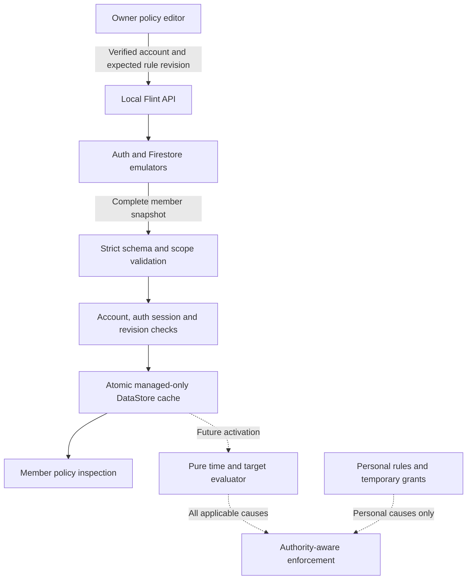

# Android managed-policy authority

This describes the local development implementation and the remaining enforcement boundary.
It is not a claim about Opal's unpublished backend. Recovered client contracts are in
[the connected evidence](../research/opal-4.14.0-connected-contracts.md); Flint's exact
wire format and server decisions are in [MANAGED_CONTRACT.md](../../connected-services/MANAGED_CONTRACT.md).

## Data flow

The solid path supports policy authoring and inspection. The dashed path is not activated.
Owner editing responses never become member enforcement authority. A member's complete
snapshot may contain memberships with no applicable policies; owner membership alone does
not subject its owner to group policies.

## Identity and persistence

An authentication session has a durable random fence and a runtime generation. Explicit
sign-in changes the fence even for the same Firebase UID. Token refresh does not create a
new login. Every asynchronous operation captures its session; a later result is publishable
only while that session is current. UI navigation has its own generation so a late response
from one group cannot update a different group's editor.

The managed cache is separate from personal `flint_preferences` data. A successful complete
snapshot replaces all memberships, rules and tombstones atomically. Missing rules are removed;
they are not retained through an additive merge. Older revisions cannot replace newer ones.
At equal revision, structural content must agree; server time is excluded from that content
comparison because a read can refresh its time anchor without changing authority.

Read, decode, transport and persistence failures are explicit unavailable/stale states. A
failed fetch is not an empty authoritative snapshot. Sign-out invalidates published identity
before suspending for disk cleanup. No bearer token or password belongs in the managed cache.

## Authoring and conflicts

The editor retains the rule revision it originally opened, including while a background
refresh finds a newer rule. Update/delete sends that original revision. A conflict requires
refresh and review; it does not silently overwrite the newer record.

Create is not idempotent. If a response is ambiguous, the client must inspect the owner list
before another submission. An HTTP 401 allows one refreshed-token retry because the service
rejected authentication before mutation. A timeout, malformed success response or server
failure after submission does not establish that the write failed.

## Time and future enforcement

Managed session instants stay fixed when the device changes timezone. Recurrence uses its
explicit IANA zone; ISO weekdays identify the start day. Intervals include their start and
exclude their end. Flint resolves a repeated start to the earlier instant and a repeated end
to the later instant. A nonexistent endpoint clamps to the transition's first valid instant;
an empty occurrence is omitted. These are documented Flint policies.

The evaluator takes an explicit confirmed clock. A saved server-time/elapsed-time anchor
cannot remain confirmed across a boot change or elapsed-clock regression. It never replaces
an unconfirmed anchor with a trusted device wall clock. This milestone does not define a
server lease, revocation push guarantee or maximum offline authorization duration.

Before activation, both foreground detectors and every block surface must:

- Retain every applicable cause with its account, membership, rule revision and occurrence.
- Check safety surfaces before restrictions and before open-limit accounting.
- Apply a personal grant only to its matching personal causes; never to managed authority.
- Re-evaluate at schedule boundaries and snapshot changes, including while an app stays open.
- Reject stale UI actions after account, membership, target, rule or period changes.
- Distinguish domain observation being unavailable from the absence of a domain restriction.
- Define offline/reboot readiness and failure behavior without inventing an authoritative grant.

Until those checks are integrated and verified, saving or inspecting a managed policy must
not be presented as device blocking, remote administration or anti-removal control.
