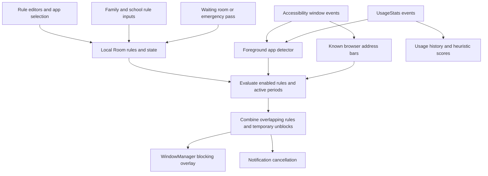
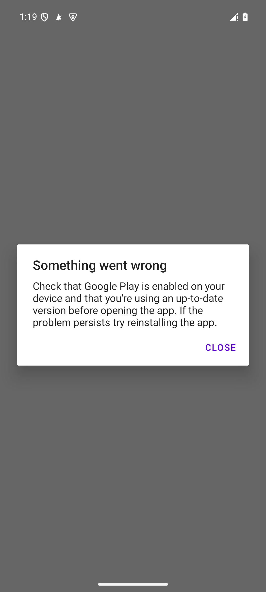

# Opal Android 4.14.0: package evidence and Flint implementation

Investigated 2026-10-11. Target: the user-supplied `opal.apkm`, not a store listing or the iOS app.

This is the initial package-analysis and historical-insights milestone. The later
[all-features delivery ledger](06-opal-android-parity.md) records the user's expanded scope,
subsequent connected-service and Timer implementations, and their separate verification.

## What this investigation establishes

This build has a native Android blocking engine, app and website selection, recurring rules,
time and open limits, temporary unblocks, historical usage reports, heuristic scores, rewards,
and managed family/school rule models. Several claims in the earlier
[feature inventory](01-opal-feature-inventory.md) are out of date for this package.

The new Flint feature is **free historical app insights on Android**: select a day in the
seven-day chart to see its apps and usage shares, or select the whole week for weekly rankings.
It uses Flint's existing local usage-event aggregation. Opal's code establishes the historical
stats feature and its entitlement gate; Flint's presentation and implementation are original.

**Coverage boundary:** this is a broad static map plus focused code/bytecode traces, not proof
that every screen works or every backend behavior is known. The initial sideload stopped at a
Google Play error; the subsequent legitimate Play installation reaches onboarding but fails
authentication with an invalid Firebase App Check token. JADX reported 262 decompilation errors; some obfuscated
methods require bytecode inspection. Server implementations and iOS behavior are absent from
this Android package. This initial analysis created no account and ran no purchase or remote
API experiment. Later Flint integration checks use synthetic accounts and local emulators.

## Artifact identity and reproducibility

| Item | Verified value |
|---|---|
| APKM SHA-256 | `843ac7e340639632b4843cbd8c4a08c2aaf9116a7b8a5ebe9ed1ec9afdeb69d9` |
| Base APK SHA-256 | `9b4348953e5da3e6a01e87ff3e76e9e059f5d3909e69a95b4d29c3d56b10710a` |
| Package | `com.withopal.opal` |
| Version | `4.14.0` / `4014000` |
| Manifest SDKs | min 29; target/compile 36 |
| Container | ZIP containing `base.apk`, ABI, density, and language splits |
| Static tooling | REA 6.4.0 archive inspection; Android SDK `apkanalyzer`; JADX 1.5.6 on local JDK 21 |
| REA evidence | `ev_34596fbccb2c62782476c20f237f1af7a21c8877ff09ddad99465aceab776606` |
| REA archive inventory | `ev_bf48184d26872844a45359b401797850f655a3d5cbb2579d57e8607deeb88071` |

[Artifact member hashes](opal-4.14.0-evidence/archive-inventory.json) tie the extracted APKs to
the supplied container. [REA's retained archive evidence](opal-4.14.0-evidence/rea-artifact.json)
is an archive observation, **not** REA decompilation evidence. REA's Android provider was
unavailable because `REA_JADX_MCP_JAR` was not configured. Standalone JADX and Android SDK
tools provided the code evidence below; no agent configuration was changed.

Full local analysis is retained in the ignored
[`android-app/build/opal-analysis/`](../../android-app/build/opal-analysis/) directory:

- `AndroidManifest.xml`: SDK manifest decoding.
- `classes.txt`: Android SDK DEX class/member inventory.
- `decompiled/sources/` and `decompiled/resources/`: JADX output; original app files are not
  imported into Flint's source or assets.
- `jadx.log`: decompilation diagnostics, including the 262-error count.
- `notification-handler.smali`: original DEX disassembly for the notification cancellation path.
- `rea-android.json`: exact missing-provider result.

To reproduce locally, extract the same `base.apk`, run `apkanalyzer manifest print`,
`apkanalyzer dex packages --defined-only`, then JADX 1.5.6 with
`--show-bad-code --threads-count 4`. The code anchors below are relative to
`android-app/build/opal-analysis/decompiled/sources/`. JADX-generated line numbers can change
with a different version. [Source hashes](opal-4.14.0-evidence/source-anchors.json) identify
the local files used for these anchors. DEX disassembly uses full method descriptors, for example:

```sh
JAVA_HOME=/opt/homebrew/opt/openjdk@21 apkanalyzer dex code \
  --class x.g0 --method 'invokeSuspend(Ljava/lang/Object;)Ljava/lang/Object;' \
  android-app/build/opal-analysis/base.apk
```

## How the blocking pipeline fits together



This diagram describes recovered static connections. It does not establish timing, OEM
reliability, or successful enforcement on a physical device.

| Area | What the package shows | Evidence and confidence |
|---|---|---|
| Foreground detection | Accessibility window-state events update a live foreground holder, excluding Opal itself; a UsageStats detector is also injected. | `cp/e.java:30–65`, `so/a0.java:17–22`, `so/g.java:21–41`; observed code. |
| Service lifecycle | Both an accessibility service and special-use foreground service can start the same enforcement host; the host fans foreground events out to enforcers. The foreground service catches rejected starts and stops itself. | `com/withopal/opal/appsshared/service/ForegroundAppMonitorService.java:94–128`, `cp/h.java:28–49`, `com/withopal/opal/feature/blockscreen/service/WebsiteDetectorService.java:138–161`; observed code. |
| Websites | Reads the active accessibility window using known URL-bar IDs for Chrome, Firefox, Samsung Internet, Edge, Brave, and Opera. Work is rate-limited to 150 ms and traversal receives a one-second deadline. | `yt/d.java:51–94`, `st/g.java:19`; `resources/res/xml/website_detector_config.xml` permits window-content retrieval. Observed code; individual browser compatibility untested. |
| Block screen | Requires draw-over-apps permission; creates a full-screen window of type 2038 with Compose content, lifecycle owners, and edge touch windows. Handles permission loss/window rejection. | `wt/h.java:40–187`; observed implementation, not an OS-level guarantee against removal. |
| Notification blocking | Posted notification package/key are passed to the blocking policy; the DEX handler conditionally calls `NotificationListenerService.cancelNotification(key)`. Own-package and non-launchable packages are excluded by policy. | Service `onNotificationPosted` at lines 64–69; `st/b.java:29–70`; `notification-handler.smali:1264–1401`. DEX confirms a call JADX failed to recover. |
| Sessions, schedules, limits | Current Room tables separate rules from session/time/open-limit details, period state, temporary unblocks, timers, and history. Actual evaluation and overlap precedence are traced in the rules notes. | `gb/r.java:491–526`, `o10/c.java:273–421`; [detailed rules evidence](opal-4.14.0-rules-notes.md). |
| App opens | Open limits track explicit unblock credits within a period. Treating this as an identical raw app-launch counter would be inaccurate. | `zp/j0.java:30–32`, `zp/k0.java:18–22`; see rules notes for the writer and evaluator. |
| Breaks and emergency pass | There is a waiting-room flow and an all-content emergency temporary unblock. This build's emergency constants specify one hour of access and a seven-day cooldown. | `xv/a.java:16–22`, `bt/p.java:2078–2094`, `aw/b0.java:152–166`; see rules notes for bytecode-checked countdown branches. |
| App categories | Ships package/domain catalogs and persists user classifications; seeding intersects installed packages with catalog entries. | `assets/categories/*.json`, `yo/l.java:27–34`, `to/r.java:516–545,644–661`; observed assets and code. Classification accuracy not assessed. |
| Historical stats | Date navigation loads prior-day reports when an entitlement boolean is true; otherwise it supplies a locked state with upgrade UI. | `tx/f0.java:2120–2131,2280–2297`, `aw/c0.java:450–456`, `tx/p.java:475–477`; observed control flow, no live subscription check. |
| Stats measurements | Sources include usage, launchable packages, health/sleep inputs, steps, app unlocks, blocking rules, and user context. | `nx/c.java:56–74`, `mx/d.java:77–113`; concrete dependencies and usage queries. Availability of every input unverified. |
| Focus and wellbeing scores | Scores use thresholds and arithmetic over measured/inferred signals. They are heuristics, not a measured quantity of productive work. | `androidx/room/q.java:159–170`, `k1/m0.java:68–95`; details below. |
| Streaks | Calls `getCurrentStreak` with a device ID and parses a numeric result, then caches/refreshes it. The server's qualifying-day rules are not in this APK. | `com/google/android/gms/internal/p000firebaseauthapi/t9.java:1127–1149`, `u20/h.java:320–351`; client call observed; server algorithm unknown. |
| Rewards | Local gemstone DTOs plus remote catalog/unlock request models and animated gem assets exist. | `com/withopal/opal/database/api/gemstone/`, `com/withopal/opal/remote/rest/gemstone/`, `assets/gem_crack/`; structural evidence only, award eligibility not fully traced. |
| Family/school | Models and persisted managed-rule state include authorities, schedules, bypass requests/reasons, memberships, and school sync workers. | `com/withopal/opal/remote/rest/managedrule/dto/`, `.../group/dto/`, `.../school/dto/`; actual policy handling in rules notes. Server authorization and rollout unknown. |
| Accounts, billing, telemetry | Manifest declares network, billing, ad identifier permissions, Firebase services, RevenueCat billing activities, Superwall paywall activity, and Adjust initialization. | Decoded manifest; bundled components establish capability/presence, not what data was transmitted or the current prices. |
| Onboarding/privacy controls | Onboarding resources and Compose paths include permission education, distraction selection, and family/school variants. Hidden-app biometric/PIN copy is present. | `tu/r.java:82`, `uu/e.java:642`, resource keys `apps_biometric_*`, `settings_pin_code_*`. Full onboarding and credential handling unverified. |

### What the scores actually mean

Recovered Focus Score thresholds are:

- 90 when distracting time is below 30 minutes and longest focus exceeds 60 minutes;
- otherwise 70 below 60 distracting minutes;
- otherwise 50 below 120 distracting minutes;
- otherwise 25.

The `longestFocus` helper at `nx/c.java:77–102` computes the largest gap in supplied pickup
timestamps, including range boundaries. An absence of phone pickups does not prove productive
work. The overall score helper starts at 70, subtracts bounded screen-time/distraction penalties,
adds bounded offline-time points and an optional sleep adjustment, then clamps to 0–100.
These recovered helpers explain this build's arithmetic; they do not establish scientific
validation, stable future behavior, or which inputs are available on every device.

Flint's new feature displays recorded foreground time, dates, and usage shares. It does not
present these proxy scores as measured focus or manufacture a long-term baseline.

## What was observed at runtime

**Follow-up:** A legitimate Google Play installation on the dedicated API 35 reference
emulator now runs the exact **4.14.0 / 4014000** build. Intro/name/provider onboarding was
captured; an Opal authentication gate remains before ordinary screens. See the
[versioned runtime evidence](opal-4.14.0-evidence/runtime/README.md). The initial sideload
trace specifically reported a wrong-installer local license check, followed by a licensing
service failure. The older screenshot below documents that initial attempt, not the current
Play-installed state.

The exact arm64 base + density + English split set installed successfully in the existing
`flint-test` Android emulator. PackageManager readback confirmed version 4.14.0, code 4014000,
min SDK 29, and target SDK 36. With emulator Wi-Fi and mobile data disabled, launching Opal
displayed a Google Play error asking for Play to be enabled/up to date. It did not reach
onboarding. The error does not establish whether connectivity, missing Play support, package
integrity, or another cause is decisive.



The screenshot and [UI hierarchy](opal-4.14.0-evidence/opal-window.xml) are runtime evidence
of that blocker only. Opal was subsequently force-stopped. No restriction permissions were
granted to it. Runtime enforcement, paywall flows, accounts, rewards, managed rules, and live
network behavior remain unverified.

## Flint feature and remaining differences

The Android Stats tab now offers a historical report using the same seven local-day windows
as its chart. Selecting a bar controls the period, total, ranked apps, and percentage denominator.
The weekly option aggregates per-package time across all seven days **before** selecting the
top apps. Date identity preserves selection across refreshes and avoids silently moving a
selected past day when midnight shifts the window. Empty records remain explicitly empty.

The implementation keeps data on device and adds no account, network request, subscription,
permission, analytics SDK, or blocking-policy change. Existing enforcement remains separate
from reporting. Android's usage-event retention and incomplete events can undercount historical
usage; a blank day is not proof that the phone was unused.

See the [feature module documentation](../../android-app/feature/feature-stats/README.md)
and [verification record](../verification/android-historical-insights-2026-10-11/README.md)
for the code paths, tests, screenshots, and precise runtime coverage. This task changes Android;
it does not claim an iOS implementation or cross-platform feature parity.

## Checklist and open questions

| Investigation question | Status |
|---|---|
| Identify the supplied build and split contents | Answered: manifest, hashes, REA archive evidence, installed package readback. |
| Explain the main blocking pipeline | Answered statically; physical-device reliability untested. |
| Trace sessions, schedules, limits, breaks, overlapping rules | Answered for recovered local paths; see rules notes and bytecode limitations. |
| Explain historical stats and score helpers | Answered for recovered paths; live input availability and entitlement behavior untested. |
| Inventory rewards, accounts, family/school, onboarding | Partially answered: code/models/resources; server policy and complete journeys unknown. |
| Explain every method, screen, backend, and anti-removal guarantee | Unresolved: obfuscation/decompilation gaps, inaccessible backend, launch blocker. |
| Build a useful corresponding feature in Flint | Implemented: Android historical app insights; validation recorded separately. |

The later expanded scope explicitly includes optional connected features. See the delivery
ledger for the local family/group/account implementation and remaining server-derived streak,
billing and production-provider work. Personal blocking and usage reporting remain local;
telemetry has not been added.
