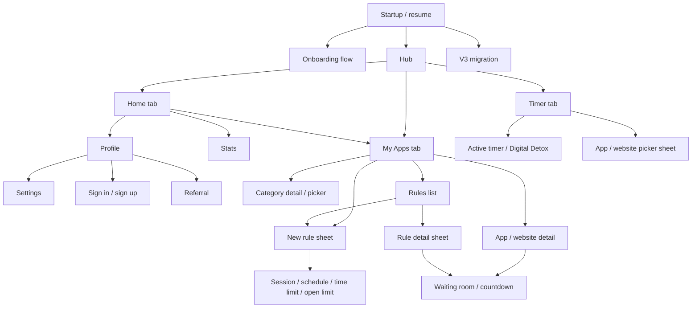

# Opal Android 4.14.0 screen and flow inventory

Static investigation of the supplied `opal.apkm`, updated 2026-10-11. This document supports
the expanded request to match the Android product, including connected services. It is a
reference inventory, not a claim that Flint already implements these flows.

## Evidence boundary

All code anchors below are relative to
`android-app/build/opal-analysis/decompiled/sources/`. They identify this local JADX 1.5.6
output; another decompiler/version can change line numbers. See the
[package analysis](05-opal-4.14.0-apkm-analysis.md) for package identity, hashes, tooling,
the existing launch-error screenshot, and the 262 reported decompilation errors.

- **Rendered:** an actual Compose rendering call and/or registered navigation destination
  was located. This is static implementation evidence; it does not mean we saw the screen.
- **Contract/model:** a route payload, state, serializer, or API declaration was located.
  This proves the client shape, not server behavior or runtime reachability.
- **Resource only:** text/art exists but no rendering path was established in this pass.
- **Runtime:** this pass acquired no new Opal screenshots. All normal application visuals,
  animation timing, insets, keyboard behavior, and server-dependent content still need capture.

Obfuscation merges application code into packages that resemble libraries, including
`androidx/room`, `com/google/android/gms/internal/…`, `c40`, and `mn`. Package names alone
are not a reliable way to exclude application behavior. No original code or artwork was
imported into Flint during this inventory pass. No remote endpoint was called.

## 1. Navigation structure

**There are three hub tabs, ordered Home, My Apps, Timer.** This is an actual ordered list
at `yx/c.java:14`. Stats and Profile are nested destinations, not extra tabs.

The diagram describes registered branches and callbacks; it does not assert every startup
predicate or back-stack result. Hub destinations are registered at `bu/f0.java:238` (Timer),
`:246` (My Apps), `:247` (RulesList), `:248` (AppCategoryDetail), `:257` (Home), `:313`
(Stats), and `:368` (Profile). Home callbacks route to Profile, Stats and My Apps at
`bu/y.java:36`, `:39`, and `:42`; RulesList is at `:51`.

Global registration also covers ActiveTimer, ActiveDigitalDetox, BlockedApps, AppDetail,
WebsiteDetail, V3MigrationIntro, Autofocus, AuthRoot, BlockScreens, and WaitingRoom settings
at `go/z.java:102–150`; the four waiting-room destinations are at `:154–162`.
Settings subroutes are registered at `go/z.java:718–734`.

### Explicit sheet registrations

| Sheet | Registration evidence |
|---|---|
| Active timer's blocked/allowed apps | `go/z.java:116–118` |
| Timer app picker | `go/z.java:429–433` |
| New rule | `go/z.java:436–440` |
| Category app picker | `go/z.java:443–447` |
| Rule detail | `go/z.java:450–454` |
| New session rule | `eu/a.java:59` |
| Onboarding app picker | `c40/c0.java:1319` |
| Inner rule editor destinations | `mn/l.java:3697–3701`, `:3912–3914`, `:4125`, `:4336–4338` |

The first five carry the explicit `com.withopal.opal.sheet.navigation.bottomSheet` metadata.
Do not flatten these into full screens before recording their actual height, drag behavior,
scrim, dismissal, and nested transitions.

## 2. Onboarding and authentication

| Surface / transition | Recovered implementation and evidence | Required runtime variants |
|---|---|---|
| Crack introduction | Registered at `c40/c0.java:1312`; `aw/r.java:981–995` invokes `ou/n.c`. Stages map to ready, cracked, deep-crack, revealed, message at `ou/n.java:580–592`; tap-to-continue at `:829`. Chat transition is constructed at `jb/f.java:142`. | All tap stages, entrance/exit animation, reduced motion. |
| Chat | Registered at `c40/c0.java:1313`; actual flow definition `mu/p1.java:55–96`. Groups include welcome, identity/name, auth gate, school invite, identity after invite, all-set, school policy, what-next, questionnaire, permissions. | New/returning user, interrupted/resumed progress, keyboard, validation, loading/error, school invitation. |
| Questionnaire | Concrete step definitions at `mu/p1.java:78`: goal, age, occupation, guessed daily screen time, echoed answers. Review delay of 3 seconds at `:80`. | Each choice list, free input, echo/review state. |
| School chat branch | `mu/p1.java:72–74`: invite, allowed/blocked apps, bell schedule, mandatory policy, privacy, notification request. Returning-school group at `:94`. | Valid/invalid/expired invite, school-provided policy, leaving invite flow, membership conflicts. |
| Permissions in chat | Permission list at `mu/p1.java:15`; enum mapping `dz/a.java:28–33` identifies Overlay then UsageAccess. Accessibility is a separate later destination. | Education, system settings, denial, grant, return/resume. |
| Projection | Registered at `c40/c0.java:1314`; entry `ru/o.java:724`; intro at `:664`, bad-news content at `:209/:227`, good-news at `:539/:548`, Continue at `:521`. | Each page and animation; actual computed values. Exact projection arithmetic was not recovered in this pass. |
| Walkthrough | Registered at `c40/c0.java:1315`; entry `tu/r.java:418` takes next/app-picker callbacks. Distractions heading at `:82`, Add apps at `:44`, remove at `:132`, Continue at `:407`; picker construction `ku/m.java:27`. | Empty/preselected distractions, additions/removal, all tutorial steps and final selection. |
| Fistbump | Registered at `c40/c0.java:1317`; `iq/c.java:116–130` invokes `pu/e.d`; disclaimer/CTA at `pu/e.java:116–118`. | Actual recommendation rows, animation, continuation. |
| Accessibility | Registered at `c40/c0.java:1318`; entry `lu/k.java:138`; explanatory Continue/Cancel dialog at `:49`, screen title at `:76`. | Dialog and Android accessibility settings/return. |
| Resume / branching | `ku/u.java:145–160` constructs route lists; `ku/s.java:138` chooses Accessibility or Walkthrough; `ku/k.java:26/:39` constructs Projection/Fistbump transitions. | Process restart at each stage; existing permissions and school membership. Decompiled startup logic is duplicated/corrupted, so exact predicates need bytecode/runtime confirmation. |
| Standalone auth | Global AuthRoot renderer at `bw/r.java:587–626` invokes `mn/k.g`; entry takes back/authenticated callbacks at `mn/k.java:1119`. | Email sign-in/up, Google account chooser, phone country picker, SMS verification, reset password, error states. |

Standalone auth fields are explicit at `up/k.java:140–163`: mode, email, password,
phoneNumber, smsCode, pendingSmsVerification, loadingAction, error, resendTimerSeconds,
resetPasswordMessage, authentication. Renderers `qw/a.java:77`, `:432`, `:528`, `:923`
cover email, password reset, phone, SMS. The SMS CTA checks six characters at `:999`.
Google/email/phone submissions are in `up/i.java:375`, `:394`, `:429`; sending and resending
SMS at `:344–359` and `:320`. Error mappings include invalid/expired code, quota, recent
login, credential conflicts and network failure at `bc/g.java:225–252` and
`mn/l.java:402–447`. This is implemented auth, not resource-only copy.

## 3. Home, My Apps and app details

| Surface | Implemented structure/actions | Evidence |
|---|---|---|
| Home | Logo/header, streak, profile action and optional school mark; score opens Stats. Content below score conditionally includes screen time, streak card and My Apps card. | Header `kx/e.java:80–119`; `kx/b.java:143–205` renders score then optional cards; `kx/i.java:399` names the three navigation callbacks. `kx/k.java:55` names score/screenTime/streak/myApps/schoolMark state. |
| My Apps | Status top card, blocked apps, blocked websites, rule cards, categories; rule list/new/detail/category/app/website/blanket-unblock callbacks. | Entry `nv/d2.java:993`; state `nv/i2.java:122–145`. Top states `nv/d2.java:52–100`; categories `:275–352`; blocked apps `:548–640`; websites `:819–835`; rules `:1315–1341`. |
| Category detail | Distracting, Always Allowed, Never Allowed. Category-to-route passes classification name; detail opens category picker. | Enum `yo/l.java:27–34`; route `bu/c0.java:31`; renderer `cv/e.java:168–221`; picker callback `bu/x.java:109`. |
| App / website detail | Add rule, unblock, reblock, reset limit, strict-block explanation; rules list/empty state; app's today unblocks, screen time and opens; category choices. | Registered `go/z.java:123/:125`; callback construction `bu/x.java:69/:74`; entry `nv/z.java:170`; actions `:439–472`; empty/rules `:638–677`; metrics `:775–809`; categories `:838–858`. |
| My Apps protection variants | PRO gate, biometric request, school-managed notice, hidden-category count, temporary all-apps unblock. | State `nv/i2.java:135–145`; managed/hidden category render at `nv/d2.java:338/:352`; blanket request at `j20/k0.java:61`. Exact gate predicates and biometric fallback need further trace/runtime. |

The screen-time example values in `lx/j.java:32` are a synthetic/example list, not observed
user usage. Classification seeding actually intersects installed apps with catalog entries
at `to/r.java:516–545`, and stored classification mapping is at `:644–661`.

## 4. Rules and pickers

The **actual New Rule menu has four choices**: Session, Schedule, Time Limit, Open Limit
(`pv/a.java:235–238`). Each callback constructs its editor route (`ht/c.java:48–57`).
Location/AI-related condition labels in resources are not evidence of additional choices in
this menu.

| Surface | Inputs / actions established in code | Evidence |
|---|---|---|
| Rules list | Empty state/first-rule suggestions; add; details; gated card with Get PRO. | `mv/a.java:90`, `:305`, `:865`, `:994`; route renderer `cv/e.java:138–165`. |
| Rule detail | Edit, disable, countdown, waiting-room unblock; resume, stop session, reset limit, unblock all are conditional actions. | Entry `mv/a.java:354`; actions `:739`, `:746`, `:758`, `:786`, `:1084`. |
| Schedule editor | Start/end time, selected weekdays, block/allow-only selection, apps/domains, hard mode and hard-mode lock, name, premium/edit/loading/committing state. | State `rv/f.java:126–150`; registered `mn/l.java:3912`. |
| Session editor | Session duration, block/allow-only selection, apps/domains, hard mode/lock, name, premium/edit/unavailable/committing states; strict-commit confirmation. | State `sv/n.java:145–166`; commit eligibility `:120–125`; registered `mn/l.java:3914`. |
| Time Limit editor | Daily minutes, selected days, block duration, resets allowed, selection mode, apps/domains, name; premium/edit/committing state. | State `uv/g.java:114–135`; renderer `uv/a.java:379`; Until/For at `:53–92`; block options at `:625–643`. |
| Open Limit editor | App opens/day, duration of each open, selected days, selection mode, apps/domains, resets allowed, name; premium/edit/commit state. | `qv/g.java:123–145`; actual field render `cv/j.java:283–284`; registered `mn/l.java:4336`. |
| Shared editor controls | Day picker, rule name editor, hold-to-commit, hard-mode confirmation, disable/delete sheet. | `aw/r.java:90`; `ba/h.java:211`; `lv/c.java:224`; `mu/g.java:1043–1046`; `mv/g.java:86–119`. |
| Selection sheets | SelectedApps, AlwaysAllowedList, AddApps; Apps/Websites tabs; Block/Allow-only; search; manual website entry, duplicate guard and Done. | Registration `r10/i.java:166–169`; tabs/mode `i0/b0.java:84/:112`; search `bu/b0.java:756`; add dialog `jt/s.java:307–362`; duplicate guard `jt/w.java:156`; Done `cw/w.java:60`. |
| Always Allowed gate | Summary, PRO restriction message and upgrade action. | `lt/o.java:229/:253/:604`. |

Time Limit block-duration options rendered in this package include until tomorrow, 5/15/30/45
minutes, 1/2/3/6/12 hours (`uv/a.java:625–643`). This alone does not prove every option is
available for every entitlement/rule source. Engine semantics, overlap precedence and
managed-rule constraints are separately traced in [rules notes](opal-4.14.0-rules-notes.md).

## 5. Timer and Digital Detox

- Timer route renders `o20/a.d` through `bw/r.java:357–390`. Entry at `o20/a.java:569`
  exposes active-timer, active-detox and picker callbacks.
- State `o20/n.java:120` includes package/domain selection, selection mode, ruler stopIndex,
  ruler mode, pending timer/detox preset, labels, navigation events and snackbar error.
- Block/Allow-only labels are actually rendered at `o20/a.java:78–89`; duration decrement
  accessibility action is at `j20/y.java:235`.
- Concrete standard presets at `j20/f0.java:37`: Deep study 90m, Commute 30m, Workout 60m,
  Reading 30m, Weekend zen 60m. Digital Detox section at `:192`.
- Hold to start is rendered at `j20/h.java:131` and `mn/q.java:322`. Leave-early confirmation
  with hold-to-leave is at `a/a.java:703–705`.
- Active selection is viewable in a sheet that explicitly disallows edits during the timer
  (`l20/f.java:125–139`; navigation `j20/k0.java:39/:45`).
- Active Digital Detox state includes title/poster/video URL, clock, blinking colon,
  engagement countdown, blocked-content state, leave confirmation and back navigation
  (`m20/f.java:119`). It requires runtime capture for media, availability and transition timing.

The resource catalog contains Digital Sabbath, No Distracting Apps, No Social Media, Quiet
Day, Retreat and Touch Grass names. This pass did not trace the full executable preset list,
so those individual offerings remain resource-only until their selector/state mapping is traced.

## 6. Stats, profile, streaks and rewards

| Surface | Confirmed client behavior | Evidence / limit |
|---|---|---|
| Stats report | Nested screen with back/date navigation, Sleep/Focus/Rest sections, loading/error and history-locked presentation. | Entry `tx/p.java:638`; section list `:46`; error `:677`; locked content `:475–477`; date window `tx/f0.java:2280–2297`. |
| Daily report data | Screen/distraction time, pickups, offline time, first/last pickup, context switches, longest focus, unlocks, sleep, steps, activity segments and user/context stats. | `qx/b.java:103`; dependencies `nx/c.java:56–74`. Model presence does not guarantee every metric is visible or populated on a given device. |
| Historical gate | Prior-day report loads only for subscribed state or today; otherwise locked state. Gate changes invalidate cached reports. | `tx/f0.java:2120–2131`; `aw/c0.java:450–472`; subscribed predicate `z10/h.java:8–16` and state label `z10/f.java:57`. |
| Score explainers | Focus, sleep, rest and overall score explanations; explicit thresholds/arithmetic. | `tx/f0.java:2087/:2246`; focus `androidx/room/q.java:159–170`; overall `k1/m0.java:68–95`; largest pickup gap `nx/c.java:77–102`. These are heuristics, not proof of productive work. |
| Profile | Loading/guest/authenticated variants; settings, sign in and referral actions; guest greeting/profile creation. | `cv/k.java:243–246`, `:295–343`, `:347–473`; route renderer `cv/e.java:43–77`. |
| Profile stats | FocusHours and DayStreak definitions and actual two-stat rendering. | `dv/i.java:23/:25`; `dv/h.java:35/:83`. |
| Streak presentation | Milestone copy for 1,2,3,5,7,10,14,20,30,50; streak/dead/at-risk states. | `lx/m.java:12–15`; `vr/a.java:24–28`. Server-defined qualifying-day criteria are unknown. |
| Referral | Code, copy/share, retry, count-dependent gift text, reward ladder and invitation acceptance. | `ev/y.java:73–113`, `:173–208`, `:361–401`, `:610–622`; rewards `ev/j0.java:128–190`; invitation `bu/b0.java:689–727`. |
| Gemstones | Local/remote catalog and unlock models, Focus/Streak/Referral/Special categories and assets exist. | `gx/b.java:18`; `com/withopal/opal/database/api/gemstone/`; REST below. Full catalog/detail/unlock rendering and route reachability were not established in this pass. |

Profile and referral are concrete screen paths. A complete gemstone gallery and family
administration screen cannot be inferred solely from their models or flags; capture or trace
their actual entry points before claiming those Android surfaces exist in this build.

## 7. Settings, account and interruption flows

Settings entry `bw/i0.java:116` explicitly names callbacks for account, Emergency Pass, Sick
Day Pass, permissions, Autofocus, block screens, waiting room, referral redeem, and sign-in.
Routes are constructed in `bu/z.java:49–70`, `:82`, `:103`, `:109`.

| Surface | Established rendering/actions | Evidence |
|---|---|---|
| Settings root | Account or login/signup; upgrade; personalize; support; social; integration; other. | `bw/g0.java:40/:44`; `bw/k0.java:76`; section functions `bw/i0.java:29–102`, `:1222/:1236`. |
| Personalize | Autofocus, Block screens, Waiting room. | `bw/x.java:34–36`. |
| Other/integration/social | Permissions, Restore purchases, About, conditional referral redemption, Opal for Mac, community/YouTube/X/Instagram/TikTok links. | `bw/u.java:42–44`; `bw/t.java:39/:52`; `bw/f0.java:42–46`. External destinations are not embedded-screen evidence. |
| Account details | Name, occupation, age, email, phone; sign out; delete account and hold-to-delete confirmation/error. | `cw/z.java:197`, `:373–478`, `:554–555`; `cw/o0.java:70–87`. Phone/Occupation routes registered `go/z.java:722/:724`. |
| Permissions | Permission sections and accessibility education; revoke dialog sends user to system settings. | Entry `ew/t.java:271`; accessibility dialog `:62`; revoke dialog `:616`. Exact OS screens vary by Android/OEM. |
| Autofocus | Settings include interventions and overlay switch/description. Overlay itself has move/hide actions and a drag hide target. | `mu/y2.java:459/:557/:709–710`; actions `mn/l.java:538–540`; hide target `qt/b.java:125`; app/today label `qt/f.java:60`. |
| Block screens | Curated selector, empty state, preview. | `mu/n.java:387/:445`; `tu/p.java:239`; `mu/m.java:647–648`. Full item catalog and remote availability still unknown. |
| Waiting room settings | Standard vs Increasing resistance selector. | `zw/b.java:111–149`; entry `zw/a.java:27`. |
| Waiting room flow | App/rule/blanket unblock; countdown gates Continue, Nevermind, duration explanation, settings action. | `ww/p.java:95/:143–144/:158/:207–209/:317/:347/:523/:536`; routes `go/z.java:154–162`. |
| Emergency Pass | Available hold-to-redeem, active pass, cooldown; ticket-style reason/access/cost/validity fields. | `aw/w.java:94–97/:379/:385`; `aw/j.java:131/:256/:352–387/:480–485`. Engine constants in rules notes. |
| Sick Day Pass | Available, redeemed, school blocking active, unavailable; reason picker and comment confirmation. School-facing comment max 280 chars. | `nw/q.java:55–81/:124–129/:173/:357–424`; `nw/i.java:116–134/:185`; `nw/f.java:27/:63–64`. |
| Referral redeem/invitation | Code submission, invitation with optional referrer name, accept, benefits; conditional availability. | `cv/j.java:156–181`; `bu/b0.java:689–727`; flag read `bw/n0.java:58`. |
| Restore result | Distinct success/failure snackbar. | `bw/k0.java:103–114`. No live billing entitlement was checked. |
| Missing permissions | Hub bubble and open-settings action. | `bu/r0.java:186`; `bu/a.java:140`. |
| Migration | Four concrete intro items: unblocked breaks, renamed rules, Autofocus, score, each with raw animation resource. | `jy/b.java:12`; route `go/z.java:130`. Resume/upgrade predicates still require verification. |

PIN-code settings, QR scanning, and some notification-setting strings exist, but this pass
did not establish their actual root-settings rendering callers. Keep them in a discovery
backlog rather than marking them as captured screens.

## 8. Route payload contracts

These are internal navigation contracts, not HTTP schemas. File names below are under
`com/withopal/opal/`; exact `toString`/constructor anchors expose the parameter names.

| Route / result | Parameters | Evidence |
|---|---|---|
| AuthRoot | `emailMode`, `startPage` | `navigation/route/AuthRoute$Root.java:50–59` |
| AppCategoryDetail | `classification` | `hub/navigation/route/RulesRoute$AppCategoryDetail.java:40–46` |
| CategoryAppPicker | `classification`, excluded package/domain lists | `hub/navigation/route/RulesRoute$CategoryAppPicker.java:63–71` |
| AppDetail / RuleDetail | `packageName` / `ruleID` | respective `hub/navigation/route/RulesRoute$…java:39–45` |
| NewSessionRule | `requestKey` | `hub/navigation/route/RulesRoute$NewSessionRule.java:40–46` |
| SelectedApps | `requestKey`, `preSelectedPackageNames`, `preSelectedWebsiteDomains`, `isAllowOnly` | `navigation/route/AppPickerRoute$SelectedApps.java:83–94` |
| AddApps | `requestKey`, excluded package/domain lists, `autoPairCatalogWebsites` | `navigation/route/AppPickerRoute$AddApps.java:72–83` |
| Picker result | package/domain sets | `navigation/route/AppPickerSelection.java:62–69` |
| ActiveTimer | `animateEntrance` | `hub/navigation/route/TimerRoute$ActiveTimer.java:39–44` |
| WaitingRoom / RuleUnblock / BlanketUnblock | `packageName, appName` / `ruleID` / `requestKey` | respective `navigation/route/WaitingRoomRoute$…java:46`, `:40`, `:40` |
| RedeemReferral | `prefilledCode`, `autoStart` | `hub/navigation/route/SettingsRoute$RedeemReferral.java:41` |
| ReferralInvitation | optional `referrerName` | `hub/navigation/route/SettingsRoute$ReferralInvitation.java:45` |

For example My Apps uses the blanket-unblock result key `my_apps_blanket_unblock`
(`j20/k0.java:61`); this is a concrete flow/result relationship rather than a screen label.

## 9. Connected-service contracts and gates

These are shipped client contracts. Their existence does not establish server authorization,
error semantics, rate limits, eligibility, availability or a right to reuse Opal's service.
Matching these capabilities in Flint requires its own service implementation/configuration.
No credentials, project configuration values, live tokens, or personal data are included here.

HTTP verbs are confirmed by the annotation decoder at `e60/t0.java:564–575`.

| Capability | Recoverable contract | Evidence |
|---|---|---|
| Streak | Firebase callable `getCurrentStreak`, input `{deviceId, force:false}`; expects response map with numeric `streak`. Invalid/missing result throws. | `com/google/android/gms/internal/p000firebaseauthapi/t9.java:1127–1149`; refresh `u20/h.java:320–351`. |
| Gemstone catalog | `GET api/v1/gemstones?locale=&page=&perPage=` → `GemstoneCatalogPageDto`. | `l00/a.java:21–22`. |
| Gemstone unlocks | `GET api/v1/gemstones/unlocked` → `UnlockedGemstonesResponseDto`; `POST` same path with `{gemstoneId}` → unit result. | `l00/a.java:15–19`; exact serialized request key `n00/g.java:24`. |
| Managed rules | `GET api/v1/me/managed-rules` → list of `DecodedManagedRuleDto`. | `q00/a.java:25–26`. |
| Bypass history/settings | `GET api/v1/me/managed-rule-bypasses?startAt=&endAt=` → list of `MyManagedRuleBypassDto`; `GET …/managed-rule-bypasses-settings` → `SelfBypassSettingsResponseDto`. | `q00/a.java:19–23`. |
| Request managed bypass | `POST api/v1/me/managed-rule-bypasses` with `{groupId, reason, comment, startDateTime, endDateTime}` → `SelfBypassResponseDto`. | `q00/a.java:16–17`; exact serializer keys `r00/k.java:24–28`. Reason enum and server-approved limits need contract expansion. |
| School / invite preview | `GET api/v1/schools/{schoolId}` → `SchoolDto`; `GET api/v1/schools/invites/{code}` → `SchoolInvitePreviewDto`. | `u00/c.java:12–16`. |
| Memberships | `GET api/v1/me/groups?subject_type=` → list of `GroupSummaryDto`; `POST api/v1/groups/invites/{code}/accept` → `MembershipDto`; `POST api/v1/groups/{id}/leave` → unit. | `o00/a.java:16–23`. Presence of broader family DTOs does not prove a family-management UI. |
| Push registration | `PUT api/v1/push/tokens` with `{deviceId, token, platform, appVersion}`; platform set to `android`; `DELETE api/v1/push/tokens/{deviceId}`. | `s00/a.java:12–16`; serializer `t00/a.java:24–30`; constructor `…/remote/rest/push/dto/RegisterPushTokenRequest.java:59–66`. |
| Device events | `POST api/v1/events`: distracting-usage batch → batch response; heartbeat event → unit. Event envelope fields include schemaVersion/eventType/eventId/emittedAt/userId/deviceId/meta/data. | `j00/a.java:15–19`; `…/remote/rest/deviceevent/dto/DeviceEventRequest.java:91–116`. Full data schemas and actual upload policy need separate review. |
| Referral code | Firebase callable `createReferralCode`, input `{userId, code}`. | `pz/s.java:776–777`. Redemption, code uniqueness and eligibility are not specified by this call alone. |
| Referral reward write | Firestore `rewards`: id, redemptionDate, updateDate, rewardSource=`referral`, rewardSourceData `{id,type}`, userId, data. Data is start/end dates for duration reward or `isHandled:false` for another reward class. | `com/google/android/gms/internal/p000firebaseauthapi/t9.java:1555–1573`. Server rules/fulfillment are absent. |
| Account deletion request | Authenticated UID required; Firestore `accountRequests/{uid}` with userId, data `{action:deleteAccount}`, creationDate server sentinel. | `v2/t0.java:490–499`. This is a request, not proof of completed account deletion. |

Explicit flags include autofocus overlay drag, heartbeat, families, gemstones, rating prompt,
referral redeem/reward ladder, school analytics/distracting usage, schools
(`ax/a.java:21–31`). The enum decompilation has warnings; current values/defaults and rollout
assignments were not fetched. `bw/n0.java:58` is a concrete referral flag caller.

PRO gating is concretely visible in history, rule cards and Always Allowed selection. The
subscription predicate at `z10/h.java:8–16` is true only for its Subscribed type and false
for Unknown/other types. Live plans, trial offers, paywall design and purchase outcomes require
runtime access. The manifest's billing/RevenueCat/Superwall components prove integration
presence, not current commercial terms. Referral-specific paywall placement has a concrete
call at `an/j.java:240`.

## 10. Required screenshot and interaction evidence

Every checked-off capture should retain package/version, emulator/device/API, viewport and
density, locale, font scale, navigation mode, account/entitlement/school state, permission
state, entry action and resulting route. Record both a screenshot and UI hierarchy where
possible. For motion, retain a short recording; a single frame cannot define timing.

| Capture set | Required states / transitions |
|---|---|
| A — startup | Launch, loading/error, fresh/resumed onboarding, migration; system bars and first hub frame. |
| B — onboarding | Every crack stage; complete chat questionnaire; inputs/errors/keyboards; all projection and walkthrough stages; app picker; Fistbump; permission education and Android grant/return. |
| C — auth | Email sign-in/up/reset, Google chooser/result, phone country selector/SMS/resend, invalid/expired/network/loading states; back and resume behavior. |
| D — hub/Home | All three tab selected states; Home with no usage and populated usage, score, streak/dead/at-risk, profile and school mark; scroll-to-Stats/Profile/My Apps transitions. |
| E — My Apps | Empty/populated, all unblocked, temporary unblock countdown, blocked app/domain, each category, hidden/biometric gate, school-managed notice, PRO-gated rule card. |
| F — details | App and website detail; no rule/one/overlapping rules, normal/strict block, temporarily unblocked, resettable/exhausted limit, metrics and category change. |
| G — rules | Empty/populated RulesList, new menu, each of four editors, day/time/duration selectors, name editor, picker return, invalid/disabled commit, hold progress, strict confirmation, edit/disable/delete, detail actions. |
| H — pickers | Apps/Websites and Block/Allow-only tabs, search/clear/no-results, selected list, manual domain valid/invalid/duplicate, always-allowed locked/unlocked; sheet drag/dismiss/nested back. |
| I — timer | Ruler/preset states, picker, start hold, active timer, blocked-content sheet, leave confirmation/cancel/commit, completion, background/resume; each executable Digital Detox preset and media loading/error. |
| J — stats | Today and prior date, date boundaries, locked/unlocked history, loading/error/empty input, Sleep/Focus/Rest and each explainer; device with/without health inputs. |
| K — profile/rewards | Guest/authenticated/loading/error, focus hours/streak, referral code/copy/share/retry, ladder locked/eligible/claimed, invitation and redemption outcomes; gemstone entry/catalog/detail/unlock if actually reachable. |
| L — settings | Root logged-out/logged-in/PRO/school; account field edits, phone verification, occupation, sign-out, delete confirmation; restore success/failure; About and outbound-link destinations. |
| M — interruptions | Each block-screen type and curated preview; Autofocus overlay show/move/hide; Standard/Increasing-resistance waiting room/countdown/cancel; emergency available/active/cooldown. |
| N — managed services | Invite preview/accept/errors; school onboarding/policy; managed category/rule; Sick Day available/unavailable/active/reason/comment; permission loss/recovery, membership leave, policy update and push-triggered refresh. |
| O — responsive/accessibility | Small/tall viewport, font scaling, keyboard/insets, TalkBack labels/focus, system back, rotations where supported, dark/light if supported, reduced motion. |
| P — commercial/server | Actual paywalls and offer states, purchase/restore/cancel, account linking/re-auth, offline/cache/timeout/retry, server flag variations, server rejection and sync conflict. Transactions require a controlled test arrangement. |

No row above is marked captured in this document. Product-complete parity needs both normal
and failure states. Family administration and full gemstone screens remain discovery items:
first locate their actual Android entry points; then add their concrete capture cases.

## 11. Milestone acceptance guidance

1. Establish a working runtime reference and capture sets A–D before adjusting navigation
   or visual tokens. Keep the launch blocker distinct from application behavior.
2. For each feature milestone, bind screenshots to route/payload contracts, state transitions,
   inputs, side effects and failure modes. Capture numeric display values with the data that
   produced them; avoid accepting a visually similar static placeholder.
3. Implement the corresponding Flint behavior independently, then compare the same states
   on a matched device configuration. Cross-check rule enforcement separately from editor UI.
4. Treat backend-owned eligibility, membership policy, rewards fulfillment, billing offers,
   catalog delivery and push behavior as explicit service deliverables. Static client models
   cannot establish the missing server algorithms.
5. Do not call the result “1:1” while uncaptured states, unreachable gates, decompilation gaps,
   unavailable services or unverified enforcement remain. Maintain the differences list per
   milestone and close it with evidence.
