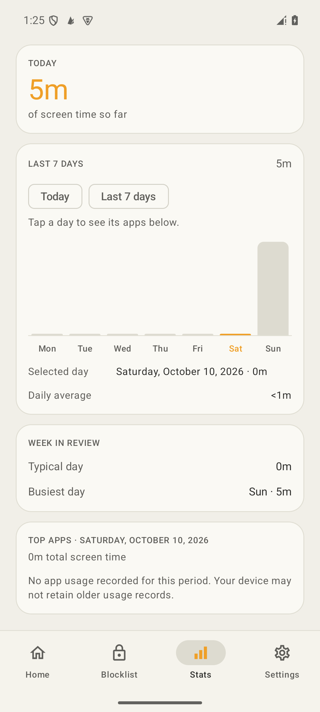
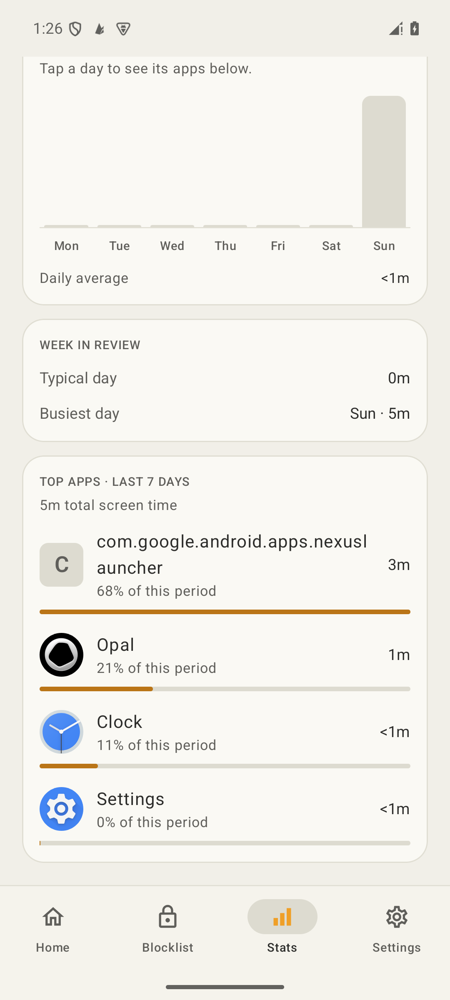

# Android historical app insights — 2026-10-11

Built and exercised the new Stats day/week selection flow on the `flint-test` emulator
(Android API 35, arm64). The installed APK's SHA-256 matches the locally verified build:
`a59be4e90ee190ecd7842794204e6ad0ca377bbf9e984f211e3773d3fc3d4159`.
See [device readback](device.json).

## Build and tests

- `:feature:feature-stats:testDebugUnitTest`: 45 tests passed, including 10 new historical
  insights tests; zero failures, errors, or skips.
- `make verify-android`: passed `assembleDebug` and the full Gradle `test` gate.
  [Full command output](verify-android.txt).
- [JUnit summary](test-summary.json): 830 test executions represented across module/variant
  XML reports, with zero failures, errors, or skips. Debug/release variants repeat some tests;
  this is not a count of 830 distinct tests. Gradle reused valid incremental/cache results.
- `git diff --check`: passed.

The new tests cover day-specific rankings and denominators, weekly accumulation, apps which
rank weekly despite never appearing in the daily top eight, totals including undisplayed apps,
date labels, refresh and moving-window selection, relative Today/Week behavior, empty records,
and foreground sessions spanning midnight.

## Emulator observations

Usage Access was already granted. The installed app was updated with `adb install -r`,
preserving its data. These screens use actual emulator usage records; no sample data was
injected into the running application.

| Step | Observed result | Evidence |
|---|---|---|
| Open Stats | Seven dated bars, Today/Last 7 days controls, today's total. | [Screenshot](01-today.png), [UI hierarchy](01-today.xml) |
| Select October 10 | Selected-day readout and app section both show Saturday, October 10, 2026; zero recorded usage and explicit retention caveat. | [Screenshot](02-selected-day.png), [UI hierarchy](02-selected-day.xml) |
| Background and resume | The October 10 selection remains after the lifecycle refresh; hierarchy assertion passed. | [UI hierarchy](03-day-after-resume.xml) |
| Select Last 7 days | App header changes to Last 7 days, total matches period, real app rows show percentages “of this period.” Hierarchy assertions passed. | [Screenshot](04-week.png), [UI hierarchy](04-week.xml) |

## Limits

The emulator had no recorded usage for the selected past day. Populated historical-day ranking,
week/day differences, midnight splitting, and window rollover were verified by deterministic
unit tests; the runtime pass establishes selection, rendering, actual current/week records,
and refresh behavior. No physical-device/OEM retention study or iOS verification was performed.
This reporting change does not modify blocking enforcement.

The inspected Opal package could not get past its Google Play launch error in this emulator.
Its blocking and subscription behavior were analyzed statically. See the separate
[Opal evidence report](../../research/05-opal-4.14.0-apkm-analysis.md) for that boundary.

The debug APK is available locally at
[`android-app/app/build/outputs/apk/debug/app-debug.apk`](../../../android-app/app/build/outputs/apk/debug/app-debug.apk).
No commit, PR, release, or remote publication was created.
